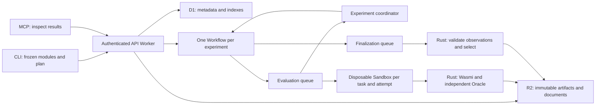

# Phase 2: Cloudflare control plane

The repository now implements the control plane and a container evaluator adapter.
Local verification covers the real Workers runtime (Workerd), SQLite Durable
Objects, D1, R2, Workflows, and the evaluator image. A live Cloudflare deployment
has completed experiments with 5, 10 and 100 known candidates, plus their baselines.
**100 simultaneous Cloudflare containers remain unverified.** The
[live validation record](cloud-validation.md) describes the deployed resources,
observed results and measurement limits. New deployments still require their own
account credentials, resources, container availability and quotas.

The supported Cell remains import-free WASM GCD. This milestone distributes
registered modules. Later milestones add [bounded agent generation and search](agent-campaigns.md)
and [private native hosting/accounts](native-hosting.md). Native candidate execution,
successive halving, isolated tenants and production rollout remain future work.
Clef integration belongs to Phase 3.

## Boundaries and execution



`ace cloud prepare` freezes the baseline and up to 100 candidates, creates a fresh
experiment identity, and writes `plan.json` plus content-addressed modules. Uploads
are raw SHA-256 checked, limited to 1 MiB and immutable. Plans are limited to
128 KiB, validated before dispatch, and must reference uploaded modules. JSON
duplicate keys, unknown fields, duplicate candidate IDs and unsafe integer seeds
are rejected. The baseline is index 0. Queue messages carry IDs, a plan transport
hash and an index; they never carry candidate code or expected Oracle outputs.

The Workflow dispatches the population to `ace-evaluations` in batches of at most
100, waits for durable completion events, and dispatches `ace-finalizations`.
Queue concurrency is configured for up to 100 evaluation consumers. This is a
requested concurrency limit, not a measured throughput or account quota guarantee.
Baseline and candidates can execute independently; selection waits for all 101
observations in a full population.

Each experiment has a coordinator Durable Object, not a global coordinator.
Transactional claims allocate exclusive 15-minute leases and fresh attempt tokens.
Each task permits three actual execution attempts; queue delivery retries and
duplicate messages do not count as evaluations. A committed result is reused on
retry. Observations are immutable at per-attempt keys; a stale lease cannot replace
an accepted observation. R2 writes precede coordinator commits, so an interrupted
attempt can leave unreferenced objects. D1 indexes are repaired on delivery retry;
the coordinator is authoritative. D1 is metadata, not raw logs.

Each task/attempt gets a distinct `EvaluationSandbox` and a fresh Container. The
current SDK is `@cloudflare/sandbox` 1.0.0: it exposes `Files` alongside the native
`ctx.container.start/exec/destroy` API. The image includes the matching
`sandbox-shim`, the release Rust CLI and a trusted JSON exporter. Internet access
is disabled, no credentials enter the guest, and commands use fixed executable
paths and argument arrays. The image runs as UID 1000. The candidate executes
inside Wasmi with no imports or WASI, bounded fuel and linear memory; it cannot
access the container filesystem, Oracle state or other candidates. Each operation
has a 12-minute adapter timeout; destruction is awaited on success or failure.

The runner's wall-clock setting is a **per-task execution budget** in this mode.
The coordinator has a one-hour experiment deadline including finalization.
Infrastructure failures or exhausted delivery/lease budgets mark the experiment
failed; they do not prove a candidate is incorrect and cannot produce a new
qualified report. No incomplete population is finalized.

## Rust remains authoritative

`ace cloud evaluate` verifies plan and module hashes and emits a sealed observation
with the task index, plan's ACE canonical hash, environment, measurements and time.
`ace cloud finish` validates seals, complete population, registration order, every
artifact, evaluator version/configuration and comparable environments. It builds
domain evidence, invokes the existing Rust policy, selects Pareto elites and the
local scoped Champion, and emits knowledge using the same functions as Phase 1.

The transport hash of plan bytes is distinct from Rust's canonical document hash.
The Worker preserves the plan bytes. Whitespace changes under an already submitted
experiment identity conflict; retry the same prepared file. Rust canonical hashes
must not be reimplemented using JavaScript's floating-point JSON serialization.
Hashes detect corruption, not malicious forgery by an operator with write access.
Authenticated evaluator bindings are the trusted provenance boundary.

All observations must have exactly the same environment fingerprint, including
CPU/kernel/architecture and evaluator source/locks/config. A heterogeneous host
population is rejected rather than assigned a misleading common environment.
This conservative rule may require controlling or grouping Cloudflare hosts before
the 100-parallel goal is met. Fuel is the objective; call timing is an observation
for the recorded environment, not production latency or a CI savings estimate.

The finalizer uploads run documents before committing `run.json` as the completed
report. D1 records accepted observations and evidence indexes. R2 retains sealed
observations, the full domain documents, raw measurements, selection and knowledge.
There is no production deployment or canonical-source replacement in this flow.

## API and MCP

Experiment routes require `Authorization: Bearer <API_TOKEN>` or an authorized
ACE account session. The public dashboard, login and one-time first-account setup
are described in [native hosting](native-hosting.md). A missing/short token fails
closed. Use a dedicated random token of at least 32 characters for the deployment.
The operator token protects one trusted deployment. ACE account roles now
intersect with explicit project membership on every resource and MCP route.
Private projects are isolated from unrelated accounts; OAuth/MFA are not implemented. Never expose coordinator or sandbox bindings as
public execution endpoints.

| Method | Route | Behavior |
|---|---|---|
| PUT / GET | `/v1/artifacts/{sha256}` | Immutable module upload / download |
| POST | `/v1/experiments` | Register exact prepared plan and start Workflow |
| GET | `/v1/experiments/{id}` | Compact status; lease tokens remain private |
| GET | `/v1/experiments/{id}/run` | Completed report; transport hash verified |
| GET | `/v1/experiments/{id}/champion` | Qualified scoped Champion, or 409 |
| GET | `/v1/experiments/{id}/knowledge` | Versioned knowledge document |
| GET | `/v1/experiments/{id}/explain/{candidate}` | Evaluation, evidence and Rust decision |
| GET | `/v1/experiments/{id}/evidence/{candidate}` | Sealed evidence document |
| GET | `/v1/experiments/{id}/files/{path}` | Completed run JSON for local verification |
| POST | `/mcp` | Stateless MCP JSON response transport |

MCP implements initialization, ping, tool listing and four read tools:
`ace_status`, `ace_champion`, `ace_knowledge`, `ace_explain`. Authentication is the
same bearer token. It advertises protocol `2025-03-26`; there is no SSE stream,
session persistence or remote command-execution tool. Register experiments through
the authenticated API/upload client.

## Develop and verify locally

After Rust activation, from the repository root:

```bash
npm ci --no-audit --no-fund
npm run check
npm test
npm run db:local
cargo test --workspace --locked
cargo clippy --workspace --all-targets --locked -- -D warnings
cargo run --locked -p ace-cli -- schema --out schemas --check
docker build -f cloud/Dockerfile -t ace-evaluator:phase2 .
npm run build:worker
```

The Workerd version is explicitly pinned by the lockfile/override to support the
selected October compatibility date; the test-pool's default runtime is older.
In a managed proxy environment, use its writable configuration/cache directories
and pass its CA through BuildKit (never disable TLS):

```bash
docker build --secret id=proxy_ca,src="$CODEX_PROXY_CERT" \
  -f cloud/Dockerfile -t ace-evaluator:phase2 .
```

The optional CA mount is only present during Cargo's networked build. Build the
image first in this environment; Wrangler's dry run can then reuse its build cache.
`npm run build:worker` builds the image and Worker without deploying or creating
remote resources. Node 24 and Docker are needed for these checks.

The original Phase 2 verification included 62 Rust tests and 11 Workerd tests: independent distributed
evaluations, 100 known registered candidates, corrupted/incomplete/stale inputs,
Oracle rejection versus evaluator Hold, replay, authentication, upload bounds,
exclusive leases, idempotency, real Workflow dispatch/events, immutable R2 writes
and D1 retry recovery. Workerd tests mock the remote Sandbox RPC boundary; they
do not claim execution on Cloudflare Containers. The reviewed six-module example
is also executed in the built image without network access, aggregated, exported
and replayed. Repeated known modules test orchestration, not AI diversity.

## Prepare deployment

`cloud/wrangler.jsonc` declares all bindings and queue topology. Its D1 UUID is a
placeholder. Before a real deployment, choose the Cloudflare account, provision
D1 `ace-metadata`, R2 `ace-artifacts` and queues `ace-evaluations`,
`ace-finalizations`, `ace-dead`; replace the D1 UUID; verify Containers/Workflows
availability and capacity for the account; apply all D1 migrations remotely (including native stores and accounts); and
configure the Worker secret `API_TOKEN`. Use account-scoped deployment credentials
through the environment's supported secret configuration, not chat messages.
The managed environment must allow the Cloudflare API and required registry hosts.
No credentials or remote resource IDs are embedded in the repository.

Deployment is a separate authorized action. Only after resource configuration:

```bash
npx wrangler d1 migrations apply ace-metadata --remote --config cloud/wrangler.jsonc
npx wrangler secret put API_TOKEN --config cloud/wrangler.jsonc
npx wrangler deploy --config cloud/wrangler.jsonc
```

To submit a prepared experiment to that deployment, set `ACE_API_URL` to the
Worker's HTTPS origin and `ACE_API_TOKEN` to its bearer token in your local shell.
The upload client rejects redirects, corrupted files and paths escaping the bundle.

```bash
ace cloud prepare examples/function-optimization --output /tmp/ace-cloud-plan
npm run cloud:submit -- /tmp/ace-cloud-plan
node cloud/scripts/download.mjs <experiment-id> /tmp/ace-cloud-run
```

Choose fresh directories. Download verifies module hashes and invokes `ace status`
to check the complete report, artifacts, domain seals and reproduced policy gates.
Replay requires the evaluator's original environment; a different local machine
may legitimately fail its environment check. Preserve the image digest and accepted
observations when validating the live deployment. Measure actual concurrency,
wall time, failures and costs before claiming the Phase 2 parallel-execution goal.
